# Site architecture

Component and page structure of the landing site (Astro, static output). Paths end with a slash — see `trailingSlash` in `astro.config.mjs`.

```mermaid
flowchart TD
    subgraph Pages["src/pages"]
        idx["index.astro<br/>(research · en · '/')"]
        research["research.astro<br/>(research · en · '/research/'<br/>canonical → '/')"]
        ru["ru.astro<br/>(research · ru · '/ru/')"]
        devIdx["dev/index.astro<br/>(engineering · en · '/dev/')"]
        devRu["dev/ru.astro<br/>(engineering · ru · '/dev/ru/')"]
        notFound["404.astro<br/>(bilingual · noindex · no canonical)"]
    end

    FacePage["FacePage.astro<br/>(orchestrates one 'face' page)"]

    subgraph Layout["src/layouts"]
        BaseLayout["BaseLayout.astro<br/>(html shell, ClientRouter, self-hosted fonts)"]
    end

    subgraph Components["src/components"]
        Seo["Seo.astro<br/>(meta, OG per face × locale, canonical, hreflang, noindex)"]
        Schema["Schema.astro<br/>(JSON-LD Person, sameAs)"]
        Topbar["Topbar.astro<br/>(eyebrow, lang switch, cross-face link)"]
        ContactLinks["ContactLinks.astro<br/>(contact nav — face × locale)"]
        NetworkViz["NetworkViz.astro<br/>(hero canvas — research only)"]
        Portrait["Portrait.astro<br/>(astro:assets — dev hero, research bio)"]
        Cards["Cards.astro<br/>('what I do' cards)"]
        Process["Process.astro<br/>('how I work' — engineering only)"]
        Facts["Facts.astro<br/>(timeline facts list)"]
        Colophon["Colophon.astro<br/>(footer, chop, colophon line)"]
        Chop["Chop.astro<br/>(inline SVG monogram, currentColor)"]
    end

    subgraph Lib["src/lib"]
        content["content.ts<br/>(CONTENT, CONTACTS, CONTACT_ORDER — single source of truth)"]
        routes["routes.ts<br/>(pathFor, altsFor, crossFor, abs)"]
        icons["icons.ts<br/>(ICONS svg strings)"]
    end

    subgraph Assets["src/assets · public"]
        portraitSrc["src/assets/portrait.png<br/>(→ AVIF, responsive widths)"]
        og["public/og/*.png<br/>(research/dev × en/ru)"]
        favicon["public/favicon.svg · favicon.ico · apple-touch-icon.png"]
        robots["public/robots.txt"]
    end

    idx --> FacePage
    research --> FacePage
    ru --> FacePage
    devIdx --> FacePage
    devRu --> FacePage
    notFound --> BaseLayout

    FacePage --> BaseLayout
    BaseLayout --> Seo
    BaseLayout --> Schema

    FacePage --> Topbar
    FacePage --> ContactLinks
    FacePage --> NetworkViz
    FacePage --> Portrait
    FacePage --> Cards
    FacePage --> Process
    FacePage --> Facts
    FacePage --> Colophon
    Colophon --> Chop
    Portrait --> portraitSrc
    Seo --> og

    FacePage -. reads .-> content
    FacePage -. reads .-> routes
    ContactLinks -. reads .-> content
    ContactLinks -. reads .-> icons
    Colophon -. reads .-> content
    Seo -. reads .-> routes
    Schema -. reads .-> content

    subgraph Styles["src/styles"]
        globalcss["global.css"]
        tokenscss["tokens.css"]
    end
    BaseLayout --> globalcss
    globalcss --> tokenscss
```

## Routes

| URL         | Face        | Locale | Notes                         |
|-------------|-------------|--------|-------------------------------|
| `/`          | research    | en     | canonical root                  |
| `/research/` | research    | en     | outreach alias, canonical → `/` |
| `/ru/`       | research    | ru     |                                 |
| `/dev/`      | engineering | en     | default engineering face        |
| `/dev/ru/`   | engineering | ru     |                                 |
| `/404.html`  | —           | en+ru  | `noindex`, not in the sitemap   |

Slashless forms answer with a 301 on both hosts, so every canonical, `hreflang`,
sitemap entry and internal link is built from `pathFor()` / `abs()` with the slash.

## Notes

- **Faces**: `research` and `engineering` — two personas sharing the same layout and
  components, driven entirely by `content.ts`.
- `FacePage.astro` is the single orchestrator: given `face` + `locale`, it pulls
  content and routes and renders the shared component tree.
- **Contacts vary by face *and* locale** (`CONTACTS[face][locale]`): RU pages show the
  Russian Telegram, EN pages the Latvian one.
- **Type**: Cormorant Garamond for the name only (display sizes), PT Serif for
  everything else, JetBrains Mono for labels. Both serif faces carry Cyrillic, so RU
  and EN pages are typographically identical.
- **No rates anywhere** — the engineering face shows availability, never pricing.
- **Reachable without VPN from Russia**: no third-party requests at runtime, fonts via
  aggregate `@fontsource` files (they carry `unicode-range`), stylesheet inlined into
  every page.
- **Deploy**: one build, two hosts — see `.github/workflows/deploy.yml` and `DEPLOY-dual.md`.
- Rules for agents: `CLAUDE.md`; verified facts: `docs/facts.md`.
